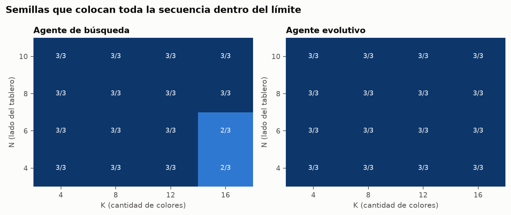
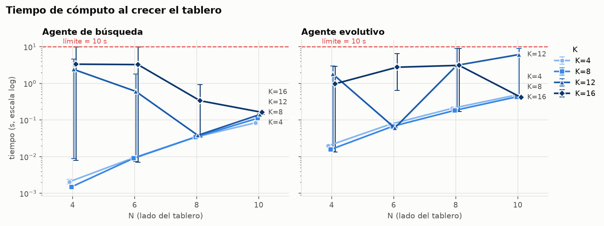
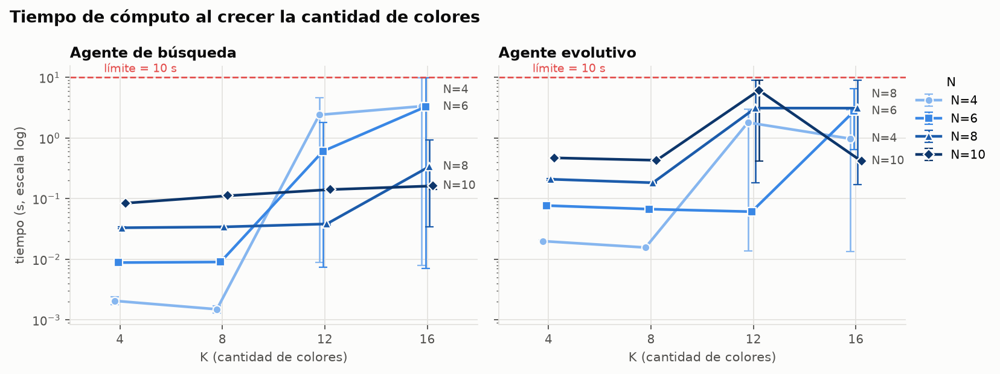
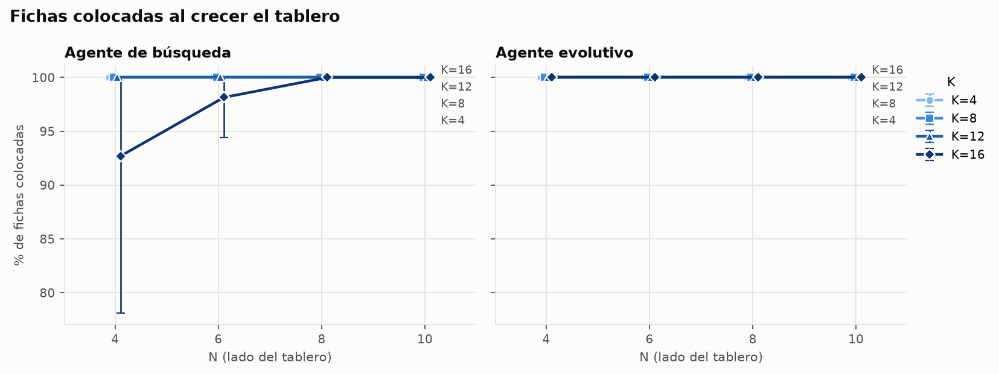
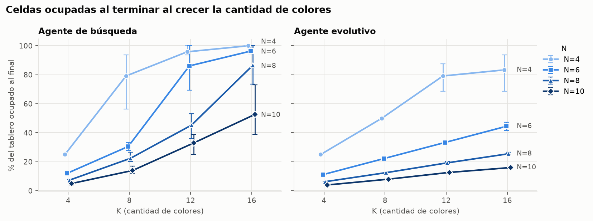

# Tarea1_IA — TileUp

## Requisitos

Python 3.9 o superior, sin dependencias externas (solo biblioteca estándar).  
Para el módulo de escalabilidad se requiere además `matplotlib` y `numpy`
(`pip install matplotlib numpy`).

---

## Ejecución rápida

```bash
# punto de entrada único (busqueda o evolutivo)
python3 main.py instancias/ejemplo.txt busqueda  1 10 solucion_busqueda.txt
python3 main.py instancias/ejemplo.txt evolutivo 1 10 solucion_evolutivo.txt

# validar una solución producida
python3 validador.py instancias/ejemplo.txt solucion_busqueda.txt
```

Con Make:

```bash
make run            # búsqueda sobre instancias/ejemplo.txt
make run-evolutivo  # evolutivo sobre instancias/ejemplo.txt
make validar        # valida solucion_busqueda.txt
make escalabilidad
make test           # corre todos los tests
```

Variables de Make: `INSTANCIA`, `SEMILLA`, `TIEMPO`, `SALIDA`.

```bash
make run INSTANCIA=instancias/ejemplo.txt SEMILLA=42 TIEMPO=30
```

## Pruebas

```bash
make test             # motor + búsqueda + evolutivo (todos)
make test-motor
make test-search
make test-evolutivo
make test-escalabilidad
```

---

## Formatos

### Formato de instancia

Archivo de texto plano. Las líneas en blanco y las que comienzan con `#` se ignoran.

```
# TileUp -- instancia de ejemplo
4 3        # N K  (tablero N×N, K colores)
6          # M    (número de fichas en la secuencia)
1 2        # color valor  (ficha 0)
2 1        # color valor  (ficha 1)
1 3
3 1
1 1
2 4
```

### Formato de solución

Una línea por colocación: `índice fila columna` (todos desde cero). Última línea: resumen.

```
0 0 0
1 1 1
2 0 1
3 2 2
4 0 2
5 1 2
# colocadas=6 ocupadas=3 mayor=6
```

---

## Agente de búsqueda

**Algoritmo:** greedy best-first search (cola de prioridad solo con h(n), sin g).

| Componente | Definición |
|---|---|
| **Estado** | Tablero (dict celda→(color,valor)), secuencia de fichas, índice `siguiente`, N, K |
| **Estado inicial** | Tablero vacío, `siguiente=0` |
| **Operador** | Tomar `secuencia[siguiente]` y colocarla en cualquier celda vacía; aplicar fusión BFS si el grupo resultante tiene ≥ 2 fichas del mismo color |
| **Factor de ramificación** | N²−celdas\_ocupadas (celdas libres disponibles) |
| **Costo por acción** | Uniforme = 1 (profundidad = fichas colocadas) |
| **Prueba de meta** | `siguiente ≥ M` (toda la secuencia consumida) |
| **Derrota** | Quedan fichas y el tablero está lleno |
| **Heurística** | `h(n) = celdas_ocupadas(n) − fichas_colocadas(n)` |

**Sobre la heurística:** mide cuántas celdas "extra" están ocupadas en relación con las fichas ya colocadas. Si cada ficha se fusiona al colocarse, la diferencia baja (o es negativa); si no hay fusiones, sube. El algoritmo prefiere estados con mayor número de fusiones pasadas.

La heurística **no es admisible** porque no intenta subestimar el costo restante hasta la meta: prioriza estados con más fusiones acumuladas, no estados más "cercanos" en número de pasos. La garantía que se pierde es la optimalidad: el agente puede no encontrar la solución con el menor número de celdas ocupadas, pero en la práctica guía la búsqueda de forma eficiente hacia partidas con pocas fichas en el tablero.

**Detección de estados repetidos:** tabla de visitados sobre `(frozenset(tablero.items()), siguiente)`. Los estados de derrota se evalúan como `mejor_nodo` candidato pero no se expanden. El límite de tiempo se revisa en cada hijo generado para garantizar que la ejecución se detiene dentro del plazo indicado.

---

## Agente evolutivo

**Algoritmo:** genético generacional con elitismo.

- **Individuo:** vector de M genes enteros en `[0, N·N)`, uno por ficha. El gen *i* es la
  celda preferida para la ficha *i* (`fila = g // N`, `col = g % N`). Si esa celda está
  ocupada, la ficha va a `vacias[g mod |vacias|]`. Así todo individuo es una partida legal
  y no hace falta reparar.
- **Aptitud (se maximiza):** `colocadas · (N·N + 1) − ocupadas`. Como `ocupadas ≤ N·N`,
  una ficha colocada más siempre vale más que cualquier diferencia de celdas ocupadas:
  es el mismo orden del concurso.
- **Población inicial:** 120 individuos; la mitad con una regla voraz (poner la ficha en la
  celda con más vecinos de su color, para que se fusione) y la mitad al azar.
- **Selección:** torneo de tamaño 2.
- **Variación:** cruce de un punto (probabilidad 1.0) y mutación por gen con probabilidad
  `0.5 / M` (el gen se cambia por una celda al azar).
- **Reemplazo:** generacional; los 2 mejores pasan intactos (elitismo).
- **Paro:** lo primero que ocurra entre: 90 % del límite de tiempo, 300 generaciones sin
  mejora, o llegar a la cota óptima (todas colocadas y una celda por color distinto).
- **Esfuerzo:** número de evaluaciones de aptitud (partidas completas jugadas).
- **Determinismo:** todo el azar sale de `random.Random(semilla)`.

### Ajuste de parámetros

Se partió de una base (población 60, torneo 3, cruce 0.9, mutación 1/M, 20 % voraz) y se
varió un parámetro a la vez, con el mismo presupuesto de 6000 evaluaciones por corrida, en
4 instancias difíciles (3×3 a 6×6 con 6 a 14 colores) y 3 semillas:

| Configuración | % fichas colocadas |
|---|---|
| Base | 91.8 % |
| Elegida (120, torneo 2, cruce 1.0, mutación 0.5/M, 50 % voraz) | 97.1 % |

---

## Estudio de escalabilidad

Este estudio mide cómo se degradan ambos agentes al crecer el tablero (**N**) y la cantidad de colores (**K**).

### Diseño del experimento

- **Generador** (`escalabilidad/generador.py`): recibe N, K, M y una semilla. Sortea colores
  uniformes en 1..K y valores en 1..9 con `random.Random(semilla)`.
- **Rejilla:** N ∈ {4, 6, 8, 10} y K ∈ {4, 8, 12, 16}, con 3 semillas por configuración.
  M = 2·N², es decir 32, 72, 128 y 200 fichas.
- **Ejecución:** cada agente corre sobre las 48 instancias (96 corridas totales), límite 10 s.
- **Reproducir:** `make escalabilidad` (ver `escalabilidad/README.md`).

### Resultados

Valores: media ± desviación estándar de las 3 semillas. Éxitos = semillas en que se colocaron todas las fichas.

**Agente de búsqueda** (esfuerzo = nodos expandidos)

| N | K | M | éxitos | colocadas | ocupadas | tiempo (s) | nodos |
|---|---|---|---|---|---|---|---|
| 4 | 4 | 32 | 3/3 | 32.0 ± 0.0 | 4.0 ± 0.0 | 0.01 ± 0.01 | 277 ± 210 |
| 4 | 8 | 32 | 3/3 | 32.0 ± 0.0 | 10.3 ± 1.2 | 1.82 ± 2.92 | 17170 ± 26185 |
| 4 | 12 | 32 | 3/3 | 32.0 ± 0.0 | 15.7 ± 0.6 | 2.02 ± 3.11 | 23678 ± 27541 |
| 4 | 16 | 32 | 2/3 | 31.3 ± 1.2 | 16.0 ± 0.0 | 3.70 ± 6.11 | 117187 ± 196354 |
| 6 | 4 | 72 | 3/3 | 72.0 ± 0.0 | 4.0 ± 0.0 | 0.26 ± 0.26 | 1344 ± 1189 |
| 6 | 8 | 72 | 1/3 | 26.0 ± 39.8 | 5.3 ± 4.0 | 6.82 ± 5.69 | 27541 ± 22684 |
| 6 | 12 | 72 | 2/3 | 49.0 ± 39.8 | 16.7 ± 11.8 | 7.02 ± 5.18 | 29317 ± 21361 |
| 6 | 16 | 72 | 1/3 | 37.0 ± 34.5 | 16.7 ± 14.6 | 8.14 ± 3.22 | 35532 ± 15191 |
| 8 | 4 | 128 | 3/3 | 128.0 ± 0.0 | 4.0 ± 0.0 | 1.71 ± 1.72 | 4182 ± 3905 |
| 8 | 8 | 128 | 1/3 | 44.7 ± 72.2 | 5.7 ± 4.6 | 7.83 ± 5.26 | 18582 ± 12325 |
| 8 | 12 | 128 | 1/3 | 44.7 ± 72.2 | 9.7 ± 11.5 | 9.64 ± 1.87 | 22893 ± 4858 |
| 8 | 16 | 128 | 0/3 | 10.0 ± 12.1 | 6.3 ± 5.8 | 10.59 ± 0.53 | 24679 ± 1766 |
| 10 | 4 | 200 | 2/3 | 134.7 ± 113.2 | 3.7 ± 0.6 | 5.92 ± 5.41 | 8691 ± 7648 |
| 10 | 8 | 200 | 1/3 | 68.7 ± 113.7 | 6.3 ± 5.8 | 9.22 ± 2.39 | 14319 ± 3389 |
| 10 | 12 | 200 | 0/3 | 4.7 ± 2.9 | 4.0 ± 1.7 | 10.18 ± 0.32 | 14657 ± 1463 |
| 10 | 16 | 200 | 0/3 | 9.7 ± 11.5 | 6.0 ± 5.2 | 10.27 ± 0.26 | 15521 ± 1418 |

**Agente evolutivo** (esfuerzo = evaluaciones de aptitud)

| N | K | M | éxitos | colocadas | ocupadas | tiempo (s) | evaluaciones |
|---|---|---|---|---|---|---|---|
| 4 | 4 | 32 | 3/3 | 32.0 ± 0.0 | 4.0 ± 0.0 | 0.02 ± 0.00 | 120 ± 0 |
| 4 | 8 | 32 | 3/3 | 32.0 ± 0.0 | 8.0 ± 0.0 | 0.02 ± 0.00 | 120 ± 0 |
| 4 | 12 | 32 | 3/3 | 32.0 ± 0.0 | 12.7 ± 1.5 | 1.92 ± 1.67 | 26591 ± 23326 |
| 4 | 16 | 32 | 3/3 | 32.0 ± 0.0 | 13.3 ± 2.1 | 1.00 ± 1.71 | 13297 ± 22823 |
| 6 | 4 | 72 | 3/3 | 72.0 ± 0.0 | 4.0 ± 0.0 | 0.08 ± 0.01 | 120 ± 0 |
| 6 | 8 | 72 | 3/3 | 72.0 ± 0.0 | 8.0 ± 0.0 | 0.07 ± 0.00 | 120 ± 0 |
| 6 | 12 | 72 | 3/3 | 72.0 ± 0.0 | 12.0 ± 0.0 | 0.06 ± 0.00 | 120 ± 0 |
| 6 | 16 | 72 | 3/3 | 72.0 ± 0.0 | 16.0 ± 1.0 | 2.87 ± 3.47 | 14791 ± 17987 |
| 8 | 4 | 128 | 3/3 | 128.0 ± 0.0 | 4.0 ± 0.0 | 0.21 ± 0.01 | 120 ± 0 |
| 8 | 8 | 128 | 3/3 | 128.0 ± 0.0 | 8.0 ± 0.0 | 0.19 ± 0.00 | 120 ± 0 |
| 8 | 12 | 128 | 3/3 | 128.0 ± 0.0 | 12.3 ± 0.6 | 3.12 ± 5.10 | 8497 ± 14509 |
| 8 | 16 | 128 | 3/3 | 128.0 ± 0.0 | 16.3 ± 0.6 | 3.11 ± 5.10 | 7885 ± 13449 |
| 10 | 4 | 200 | 3/3 | 200.0 ± 0.0 | 4.0 ± 0.0 | 0.47 ± 0.01 | 120 ± 0 |
| 10 | 8 | 200 | 3/3 | 200.0 ± 0.0 | 8.0 ± 0.0 | 0.45 ± 0.01 | 120 ± 0 |
| 10 | 12 | 200 | 3/3 | 200.0 ± 0.0 | 12.7 ± 0.6 | 6.15 ± 4.94 | 9119 ± 7827 |
| 10 | 16 | 200 | 3/3 | 200.0 ± 0.0 | 16.0 ± 0.0 | 0.40 ± 0.01 | 120 ± 0 |

En las gráficas, el punto es la media entre semillas y la barra es el rango (mínimo a máximo).











### Lectura

**¿Qué parámetro domina el costo?**

En la **búsqueda** ninguno de los dos actúa solo: N fija el tamaño del problema y K decide si la heurística sirve. N define el factor de ramificación (una acción por celda vacía, hasta N²) y la profundidad (M = 2·N²). La heurística *ocupadas − colocadas* solo baja cuando hay fusión. Con pocos colores casi toda jugada fusiona y la búsqueda va directo a la meta (N=8, K=4: 1.7 s). Con muchos colores casi ningún hijo fusiona, muchos empatan en la heurística y la búsqueda se comporta casi como una búsqueda en anchura. Partiendo de N=4, K=4, subir N a 10 multiplica el tiempo por ~499 y subir K a 16, por ~312. En el **evolutivo** domina K: con K ≤ 8 la población inicial voraz ya alcanza la cota óptima (una celda por color) y se detiene tras 120 evaluaciones. Su tiempo solo crece linealmente con N, por el costo de jugar cada partida. Con K ≥ 12 la cota casi nunca se alcanza enseguida, así que corre hasta que deja de mejorar: miles de evaluaciones y de 1 a 6 s.

**¿Dónde deja la búsqueda de terminar dentro del límite?**

Con K = 4 aguanta hasta N = 8 y falla en N = 10 (1 de 3 semillas). Con K = 8 y K = 12 falla desde N = 6, y con K = 16 ya falla en N = 4. Los 22 fallos son por tiempo. El quiebre es abrupto y depende mucho de la secuencia: por ejemplo, N=6, K=8 coloca 26.0 ± 39.8 de 72 fichas. Cuando se corta, entrega una solución con muy pocas fichas (4.7 de 200 en N=10, K=12).

**¿Cómo se comporta el evolutivo en ese régimen?**

En las 22 corridas donde la búsqueda falló, el evolutivo colocó todas las fichas, con 1.90 s de media, y nunca excedió el límite: se detiene al 90 % del tiempo. Dentro de la rejilla probada no se encontró el punto en que empiece a perder fichas.

**Calidad.**

Cuando ambos agentes completan la secuencia, el evolutivo deja igual o menos celdas ocupadas. Con K ≤ 8 llega exactamente a la cota; con N=4, K=12 deja 12.7 celdas contra 15.7 de la búsqueda. En tableros grandes la búsqueda aparenta ocupar menos celdas solo porque colocó pocas fichas, y el concurso ordena primero por fichas colocadas.

**Conclusión.**

La búsqueda solo sirve en el régimen pequeño: N ≤ 4 con cualquier K, o N ≤ 8 con K = 4. Fuera de él se corta por tiempo y entrega soluciones casi vacías. El evolutivo escala a toda la rejilla, con un costo que depende sobre todo de K y que queda acotado por el límite de tiempo. Por eso es el agente que conviene presentar al concurso.

## Declaración de IA

La inteligencia artificial se utilizó principalmente como herramienta de apoyo para la identificación de errores, la propuesta de mejoras y la optimización de la implementación. Asimismo, desempeñó un papel importante en la elaboración y organización de la documentación del proyecto. Cabe destacar que todas las sugerencias y contribuciones generadas mediante IA fueron revisadas y validadas por el equipo de desarrollo, con el fin de garantizar que las decisiones adoptadas y la implementación final cumplieran con los requisitos de funcionalidad y los estándares de calidad establecidos.

